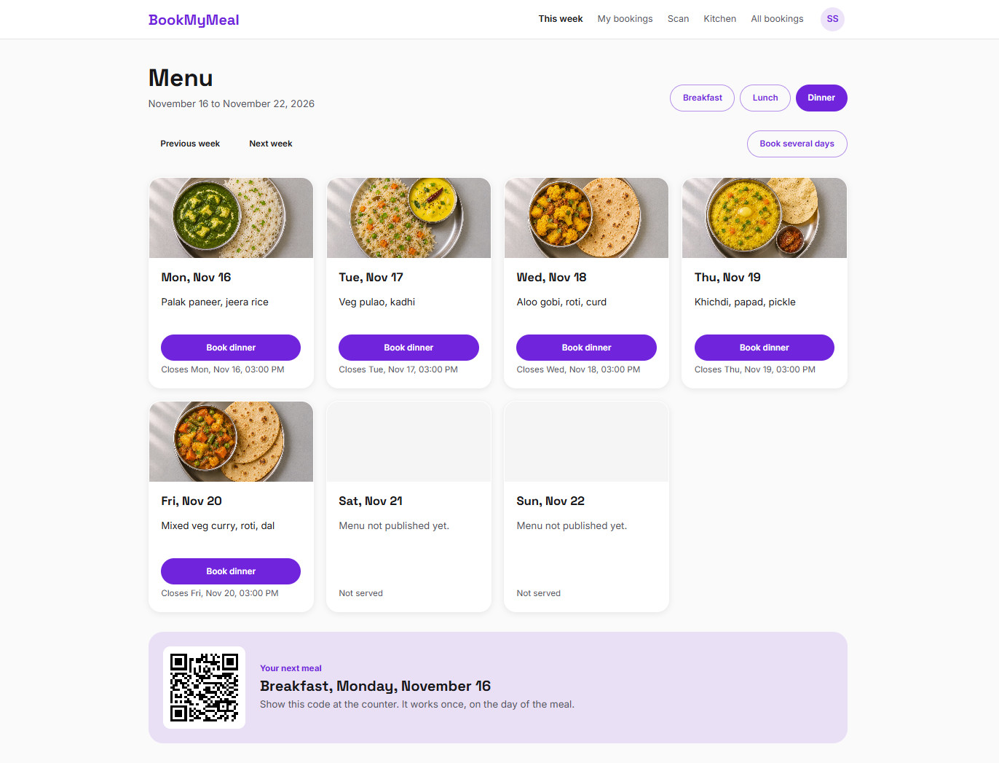
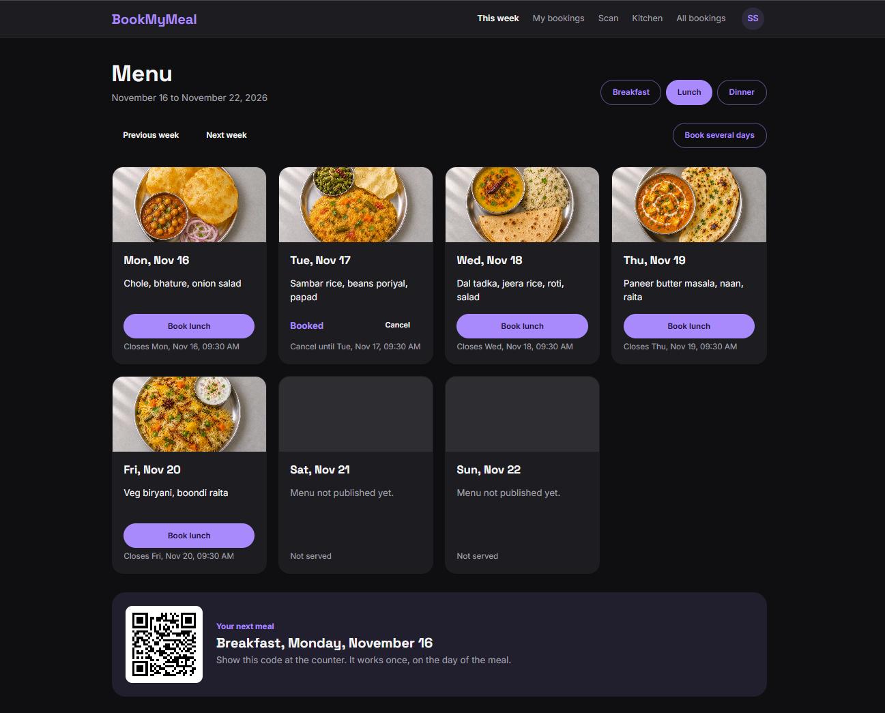
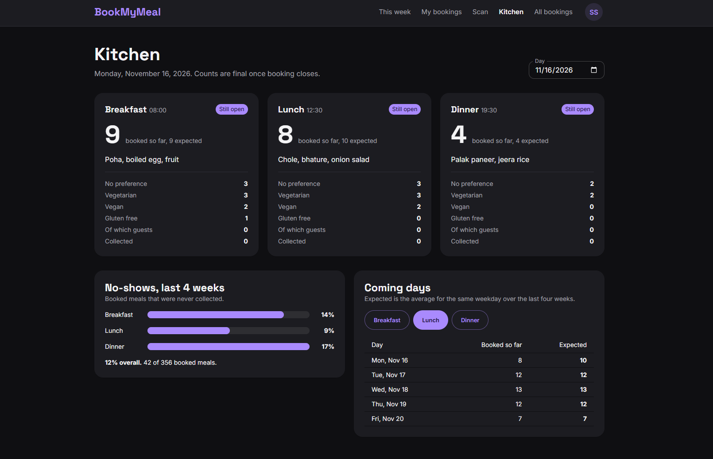
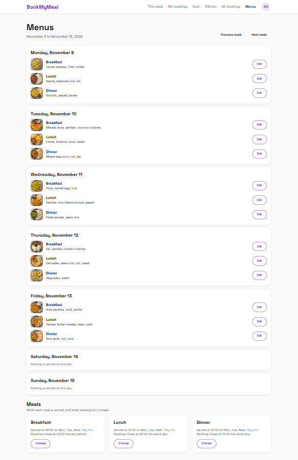
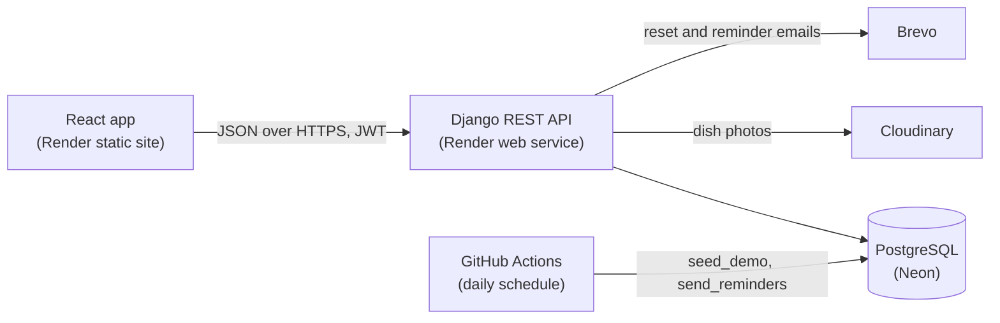

# BookMyMeal

An employee meal booking web app. Employees pre-book canteen meals, the kitchen sees how many to prepare, and each booking carries a QR coupon that is scanned once when the meal is collected.

**Live demo: https://bookmymeal.onrender.com**

| Sign in as | Email | Password |
|---|---|---|
| Employee | `employee@example.com` | `DemoPass#2026` |
| Canteen staff | `staff@example.com` | `DemoPass#2026` |
| Admin | `admin@example.com` | `DemoPass#2026` |

The demo runs on free hosting that sleeps when idle, so the first sign-in can take up to a minute. The demo data is topped up every day.

## Screenshots

| Week view, light | Week view, dark |
|---|---|
|  |  |

| Kitchen dashboard | Menu management |
|---|---|
|  |  |

## What it does

**Employees**
- See the week's menus with dish photos, and book or cancel until each meal's cut-off time
- Book several days at once from a calendar, as a date range or as hand-picked days
- Book for a guest, with the guest's dietary preference
- Show a QR coupon at the counter; the next meal's coupon is always on top
- Set a dietary preference, switch email reminders on or off, and use light or dark mode

**Canteen staff**
- Scan coupons with the phone or laptop camera, or type the code
- See today's prep sheet: how many of each meal, split by dietary preference
- See booked versus collected meals, the no-show rate, and expected bookings for the coming days
- Search and filter every booking

**Admins**
- Manage meals: serving time, booking cut-off, and the weekdays each meal is served
- Manage daily menus and their photos

## Tech stack

- **Backend:** Python 3.12, Django 5.2 (LTS), Django REST Framework, SimpleJWT, PostgreSQL (SQLite locally)
- **Frontend:** React 19, TypeScript (strict), Vite, Redux Toolkit / RTK Query, MUI, React Router
- **Testing:** 95 backend tests (Django test runner), 23 frontend tests (Vitest, Testing Library)
- **CI:** GitHub Actions runs the backend tests on SQLite and PostgreSQL, checks that migrations match the models, and type-checks, tests and builds the frontend on every pull request
- **Hosting:** Render (API and static site), Neon (PostgreSQL), Cloudinary (photos), Brevo (email), GitHub Actions (daily jobs)

## Architecture



The React app holds no business rules. Cut-offs, serving days, one-booking-per-meal and coupon redemption are all enforced by the API and covered by its tests, so the rules hold whatever client calls it.

## Design decisions

- **A coupon can be redeemed exactly once.** Redemption is a single conditional database update ("mark redeemed where not yet redeemed"), not a read followed by a write. If two scanners read the same coupon at the same moment, one succeeds and the other is told it was already used.
- **Duplicate bookings are impossible, not just unlikely.** A database constraint allows one own booking per person, meal and date. Guest bookings are exempt, because one employee may bring several guests.
- **Cut-offs follow the canteen's time zone.** Each meal has a cut-off time and a "days before" value (breakfast closes the evening before). The tests freeze the clock and CI runs in a non-UTC time zone to prove the rules do not depend on where the server is.
- **Sessions can be ended from the server.** Refresh tokens rotate on use and are blacklisted on sign-out, and "sign out everywhere" revokes every session. Access tokens last 30 minutes, so a revoked session can stay usable for up to that long; that is the usual trade-off of stateless tokens.
- **The forecast is a baseline, not machine learning.** Expected bookings are the average for the same meal on the same weekday over the last four weeks, never below what is already booked. It is easy to explain to kitchen staff and easy to check.
- **One token refresh at a time.** When several requests find the access token expired together, the frontend sends one refresh request and the rest wait for it, so rotation never invalidates a token another request is about to use.
- **Photos and email use HTTPS APIs.** The free web host wipes its disk on each deploy and blocks SMTP ports, so photos go to Cloudinary through a small custom Django storage class and email goes through Brevo's API through a custom email backend.

## Run it locally

### Backend

```bash
cd backend
python -m venv .venv
source .venv/bin/activate        # Windows: .venv\Scripts\activate
pip install -r requirements.txt

cp .env.example .env             # then set DJANGO_SECRET_KEY in .env
python manage.py migrate
python manage.py seed_demo       # demo meals, menus, accounts and booking history
python manage.py runserver       # http://127.0.0.1:8000
```

`seed_demo` prints the demo sign-ins (an admin, a canteen staff member and an employee). To create your own admin instead, run `python manage.py createsuperuser`.

Generate a secret key with:

```bash
python -c "from django.core.management.utils import get_random_secret_key; print(get_random_secret_key())"
```

With no SMTP credentials in `.env`, emails such as password reset links are printed to the server console.

Run the backend tests with `python manage.py test`.

### Frontend

```bash
cd frontend
npm install
npm run dev                      # http://localhost:3000
```

Run the frontend tests with `npm test`.

The frontend expects the API at `http://127.0.0.1:8000/api/`. To point it elsewhere, copy `frontend/.env.example` to `frontend/.env` and change `VITE_API_URL`.

## API overview

All endpoints are under `/api/` and need a JWT access token (`Authorization: Bearer <token>`), except register, login and password reset.

| Endpoint | Who | What |
|---|---|---|
| `POST register/`, `POST login/` | anyone | Create an account, get tokens |
| `POST resetpasswordemail/`, `POST resetpassword/<uid>/<token>/` | anyone | Request and use a password reset link |
| `GET profile/`, `PATCH profile/` | signed in | Your account and role; edit name and dietary preference |
| `POST changepassword/` | signed in | Needs `current_password` |
| `POST logout/`, `POST logout-all/` | signed in | End this session, or every session on all devices |
| `GET meals/` | signed in | Meal slots and their booking cut-offs |
| `GET menus/?date_from=&date_to=` | signed in | What is being served |
| `POST meals/`, `POST menus/` (and edit, delete) | admin | Manage meals and menus. A menu can carry a dish `photo` (multipart upload) |
| `GET bookings/` | signed in | Your bookings (staff and admins see everyone's) |
| `GET bookings/availability/?meal=&date_from=&date_to=` | signed in | Per day: still open, when it closes, and your own booking if any |
| `POST bookings/` | signed in | Book `{meal, date}`, `{meal, start_date, end_date}` or `{meal, dates: [...]}`, optional `guest_name` |
| `DELETE bookings/<id>/` | owner, admin | Cancel before the cut-off |
| `POST bookings/redeem/` | staff, admin | Redeem a scanned `coupon_code`. Works once per coupon, on the day of the meal |
| `GET kitchen/prep-sheet/?date=` | staff, admin | How many of each meal to prepare, split by dietary preference |
| `GET kitchen/attendance/?date_from=&date_to=` | staff, admin | Booked versus redeemed, and no-show rates |
| `GET kitchen/forecast/?days=` | staff, admin | Expected bookings for the coming days |

**Redeeming once only.** Redemption is a single conditional database update ("mark redeemed where not yet redeemed"), so if the same coupon is scanned twice at the same moment, exactly one scan succeeds.

**Forecast.** A simple, explainable baseline: the average bookings for the same meal on the same weekday over the last four weeks, never below what is already booked.

**Serving days.** Each meal has the weekdays it is served on, Monday to Friday by default. Other days cannot be booked, and a date range simply skips them.

Booking rules enforced by the server: one own booking per person, date and meal; no bookings or cancellations after the meal's cut-off; redeemed bookings cannot be cancelled.

## Email reminders

`python manage.py send_reminders` emails each user who has reminders on a list of tomorrow's booked meals. On the live demo a scheduled GitHub Actions workflow runs it every evening. Locally, with no email settings, the emails are printed to the console.

## Deployment

The live demo runs entirely on free plans. The steps, and the settings each service needs, are in [docs/DEPLOYMENT.md](docs/DEPLOYMENT.md).

## Known limits

- The API sleeps after 15 idle minutes; the next request takes up to a minute.
- Emails are sent from a free-mail address, so password reset and reminder emails may land in the spam folder.
- Mail to the `@example.com` demo accounts is never sent. Register with a real address to see an email arrive.
- The forecast is a four-week average and does not account for holidays or events.

## Background

BookMyMeal began as an internship project that was left unfinished: an early Django and React prototype with sign-in and a basic booking form. This repository is a full rebuild of that idea, done in reviewed pull requests: the data model and booking rules first, then coupon redemption and the kitchen views, then a new TypeScript frontend, tests, CI and deployment.
